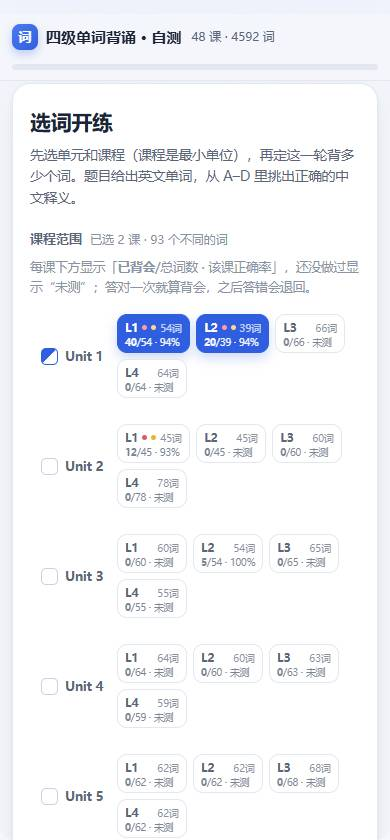
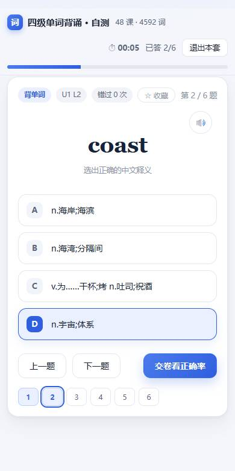
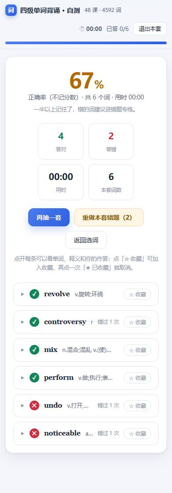

# 四级背单词 · 自测系统

> 配套 **刘晓燕《英语四级你还在背单词吗》** 课程的离线背词 + 自测工具。
> 48 个词表、4592 个单词，手机 App 和网页双端，装好就能用，不联网、不注册、不记分数。

<p>
  
  
  
</p>

---

## 这是什么

背单词最难的不是第一遍，是**第二遍、第三遍**：怎么知道哪些词真的记住了、哪些只是眼熟？
这个工具只做一件事——把课程里每个词表变成一份随机的四选一自测卷，做完告诉你**正确率**，
并且记住每个词错过几次，下次专挑没记住的练。

和课程的关系很简单：**一个 Lesson 就是讲义里的一个词表**，Unit / Lesson 编号与课程顺序一一对应
（48 个词表全部收录，见下面的[对照表](#与课程的对应关系)）。上课前先自测一遍，下课后再测一遍，
错词本会自己攒出来。

## 三种用法

| 方式 | 适合 | 怎么开始 |
| --- | --- | --- |
| **安卓 App**（推荐） | 手机上每天刷 | 下载 [`四级背单词.apk`](四级背单词.apk)（v1.6，约 150 KB）安装 |
| **在线版**（免安装） | 手机上不想装 App | 直接打开 <https://kingwuzhi.github.io/cet4-words/> |
| **网页文件** | 电脑、离线、随便拷 | 下载 [`index.html`](index.html)（文件页右侧的 Download 图标），双击用浏览器打开 |

三者是**同一份代码**：记录存在本机（localStorage 或安卓 SharedPreferences），不上传任何地方。
两边都练过？用「导出存档 / 导入存档」把记录合到一起，见[存档与迁移](#存档与迁移)。

## 功能

- **按课练习**：选 Unit → 选 Lesson（1~4 课，也可以整个 Unit 一次选中）→ 定题量 → 开始。
- **四种题型范围**：整本书随机、只练选中的课、错题专练、收藏专练。
- **抽词方式**：随机抽 / 薄弱优先（错过越多越容易被抽到）。
- **交卷只看正确率**：不评分、不排名、不给你"及格线"的压力；同时列出这一轮的错词，可一键收藏。
- **课程进度**：每一课都显示「已背会 / 总词数 · 该课正确率」，红点＝有词待复习，金星＝有收藏。
- **错词本**：按 Unit / Lesson 筛选，点 U1 L3 就只剩这一课的错词；不选就是全部。
  每个词都标着它来自哪一课，答对过的会盖一个「已背会」的章，但**不会被自动删除**。
- **收藏本**：随手标星，随时单独练一遍。
- **朗读**：点喇叭读单词（网页用浏览器 TTS，安卓用系统 TTS）。
- **键盘操作**：`A`–`D` / `1`–`4` 选答案，`←` `→` 翻题，`Enter` 下一题 / 交卷。

## 怎么用

1. **选范围**：上面选 Unit（可多选），再点具体的 Lesson。选课数量、题量都会记住，下次直接开始。
2. **定题量**：10 / 15 / 20 / 30 / 50 / 全部，或自己填。
3. **开始**：每题一个英文单词 + 四个中文释义，干扰项从**同一批词**里抽，不会冒出不相干的词。
4. **作答**：选完不立刻判对错，可以回头改，全部做完点「交卷看正确率」。
5. **看结果**：只有正确率 + 这一轮的错词清单。错词可以顺手加收藏。
6. **反复**：下次用「薄弱优先」，错过的词会先出现；错词本越用越准。

## 与课程的对应关系

讲义一共 48 个词表（Unit 1–12 × Lesson 1–4），本工具一一对应，词数如下：

| 单元 | L1 / L2 / L3 / L4 | 合计 |
| --- | --- | --- |
| Unit 1 | 54 / 39 / 66 / 64 | 223 |
| Unit 2 | 45 / 45 / 60 / 78 | 228 |
| Unit 3 | 60 / 54 / 65 / 55 | 234 |
| Unit 4 | 64 / 60 / 63 / 59 | 246 |
| Unit 5 | 62 / 62 / 68 / 62 | 254 |
| Unit 6 | 51 / 67 / 77 / 68 | 263 |
| Unit 7 | 37 / 59 / 56 / 42 | 194 |
| Unit 8 | 56 / 66 / 60 / 59 | 241 |
| Unit 9 | 46 / 57 / 45 / 64 | 212 |
| Unit 10 | 54 / 47 / 73 / 58 | 232 |
| Unit 11 | 311 / 306 / 323 / 314 | 1254 |
| Unit 12 | 300 / 322 / 324 / 65 | 1011 |
| **合计** | **48 个词表** | **4592** |

> Unit 11、12 的每一课都有 300 词上下（讲义里是整块词表），一次背不完很正常，
> 建议选上之后把题量设成 30，分几轮刷完。

## 记录的判定口径

工具不猜你的水平，只用你实际答题的结果算：

- **背会**：这个词**最近一次**作答是答对的。之后答错，立刻退回"没背会"。
- **该课正确率**：这一课所有作答里答对的比例 = `答对次数 / (答对 + 答错)`。
- **错词本**：答错过的词**永久保留**，不提供手动移出，也不会因为后来答对就消失——
  它记录的是"我在这里摔过"，不是"我现在的水平"。行内标注的「已背会」表示这个词后来答对过。
- **薄弱优先**：按每个词的错误次数排序抽题。

## 存档与迁移

文件 → 存档与迁移：

- **导出存档**：生成一个 `.json`（约几 KB）。安卓上弹系统"保存到文件"对话框，浏览器里直接下载。
- **导入存档**：选文件，或者把 JSON 文本粘进去（微信里传文本比分传文件方便）。
  导入前会预览——存档时间、包含多少词、多少收藏，以及你现在本机的情况——然后二选一：
  - **合并**：次数相加，同一个词以时间较新的状态为准，收藏取并集。适合两台设备都练过。
  - **覆盖**：整份替换，选课和抽词方式也一起恢复。适合换手机、重装后恢复备份。

存档里只有作答数据，不含词库（词库内置），所以换版本、换设备都能用。

> 同一份存档别重复「合并导入」，次数会累加；恢复备份请用「覆盖导入」。

## 数据与词库

`data/words.json` 是本工具的全部词库，结构很简单：

```json
{ "U1 L1": [ { "w": "universe", "m": "n. 宇宙；体系" }, ... ], ... }
```

想加词、改释义，直接编辑这个文件（或 `build/app.template.html` 里的页面），然后：

```bash
python tools/build.py        # 重新生成 index.html
```

## 自己编译 APK

不需要 Android Studio，也不需要 Gradle，用系统里的 Android SDK 直接编译（约 10 秒）：

```powershell
python tools/build.py                                  # 生成网页（写入 android/assets/index.html）
powershell -NoProfile -ExecutionPolicy Bypass -File android\build.ps1
```

依赖：Android SDK（build-tools + platforms/android-34）、JDK 17+、Python 3。
`build.ps1` 会自动找 SDK 和 JDK，找不到会提示你设 `ANDROID_SDK_ROOT` / `JAVA_HOME`。
细节见 [android/README.md](android/README.md)。

## 目录结构

```
index.html                 单文件网页版（词库、样式、逻辑全在里面，可离线双击打开）
四级背单词.apk              安卓安装包
data/words.json            词库数据（48 个词表 / 4592 词）
build/app.template.html    页面模板（改界面改这里）
tools/build.py             把词库注入模板，生成 index.html
tools/parse_words.py       从 PDF 词表提取单词与释义（需要你自己的 PDF）
android/                   安卓工程：WebView 外壳 + 桥接层 + 打包脚本
docs/                      README 用图
```

## 版权与免责声明

- 本项目是**个人学习工具**，与课程作者、出版方没有隶属关系，也不是官方配套产品。
- 词库整理自课程配套讲义，**单词表与释义的版权归原作者及出版方所有**，在此仅作个人学习用途，
  不用于任何商业目的，也不包含讲义原文、音频或视频。
- 代码部分以 MIT 协议开源（见 [LICENSE](LICENSE)），欢迎拿去改成别的词表。
- 若权利人认为本项目不妥，请通过 Issue 联系，会立即删除相关内容。

## 致谢

- 刘晓燕老师《英语四级你还在背单词吗》—— 词表结构与课程顺序均以此为准。
- 界面沿用了一个早期自测页面的排版：一屏一题、不打分、不弹提示。

---

MIT License（仅代码） · 词库版权归原权利人 · 数据只存在你自己的设备上